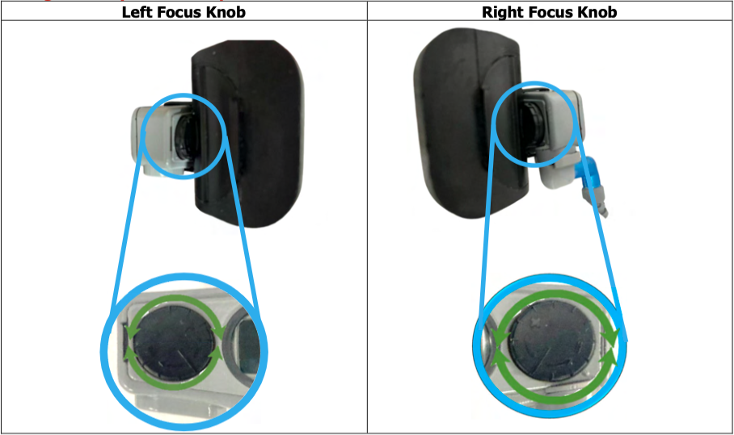
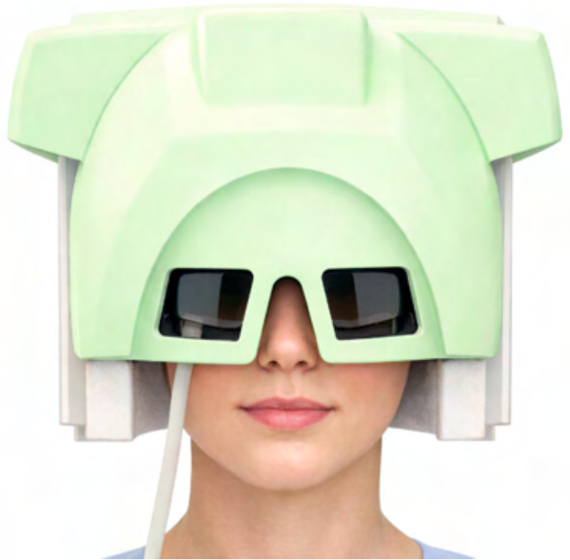
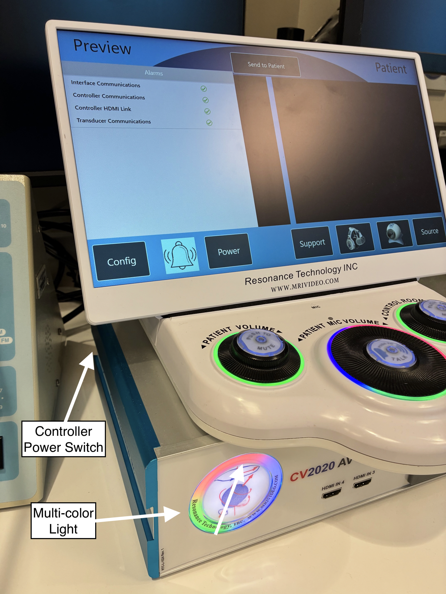
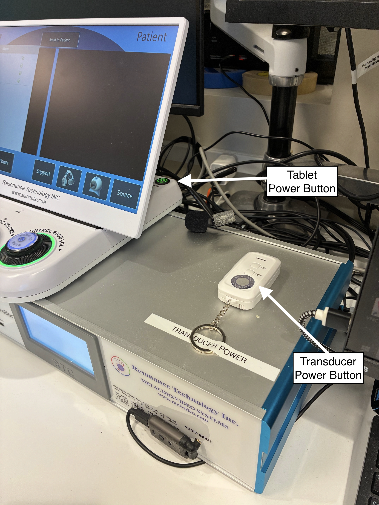
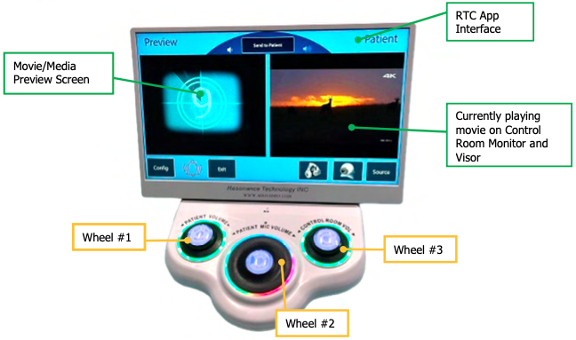
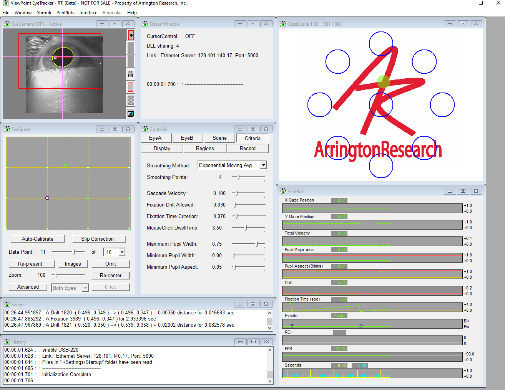

# CinemaVision Goggles
The CinemaVision system can present video and audio to the participant while also allowing for eyetracking through Arrington software. The goggles can present video and eyetrack while the separate headset presents audio. The CinemaVision goggles can be used with other audio systems available at the scanner. 

## Participant Setup
- While the participant is laying down with their head in the posterior head coil, place the goggles on the eyes. 
- Adjust the goggles for comfort, fit, and image focus. Focus can be adjusted using the knobs near the front of the visor, behind the mask. 
!!! warning
    Do not force rotation of the focus knobs. Excessive force may cause damage.
<figure markdown="span" style="text-align: center;">
    { width="400" }
</figure>
- Place the anterior head coil over top.
<figure markdown="span" style="text-align: center;">
    { width="250" }
</figure>

## Operation
- Power on the controller in the console room. The power switch is on the back left side of the controller box.
- After the controller multi-color lights are on and spinning, power on the tablet. The power button in on the right side of the tablet stand.
- After the tablet interface is started, power on the transducer. The remote switch is taped to the top right side of the controller box.
- Tap the *bell icon* on the tablet to ensure the full system is working correctly. All items should show a green checkmark.

{ style="width: 55%; height: auto;" }

{ style="width: 55%; height: auto;" }

- Use wheels 1, 2, and 3 to control the patient headset volume, patient microphone volume, and system audio volume, respectively.
- Load a video by tapping *Source* and browsing for the desired video. Tap it and it will display on the left preview screen. Tap *Send to Patient* to send the previewed video to the patient, which will now play on the right screen.
</figure markdown="span" style="text-align: center;">
    { width="450"}

## Eyetracking
- Open the Arrington ViewPoint software on the 3T-D stim PC.
- When the eye is visible in the viewing window, use the pupil locator tool to click and drag a box over the eye. The software should now be tracking the pupil.
</figure markdown="span" style="text-align: center;">
    {width="400"}
